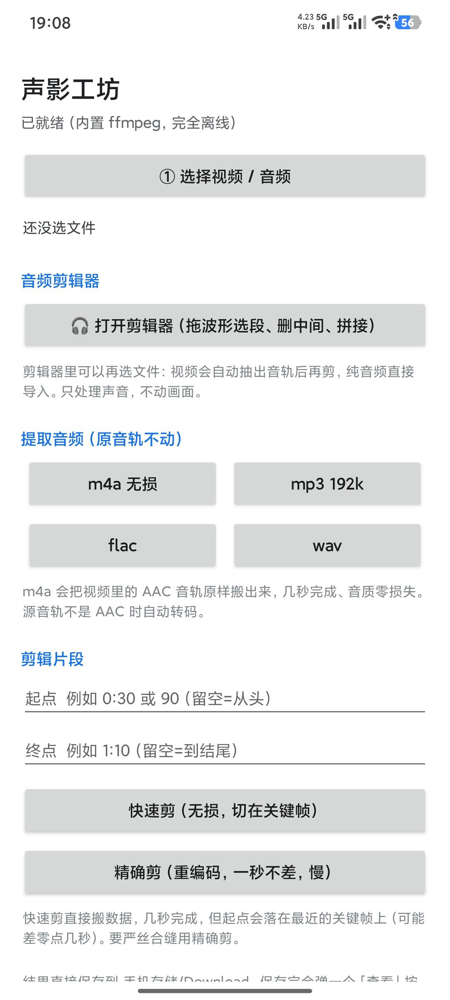
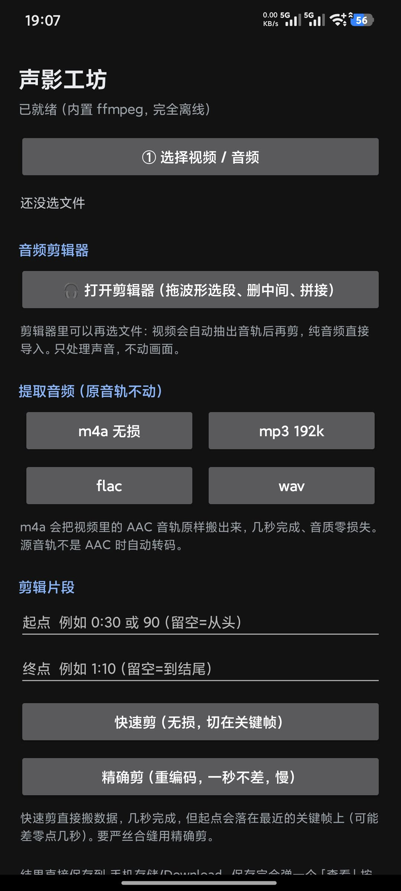
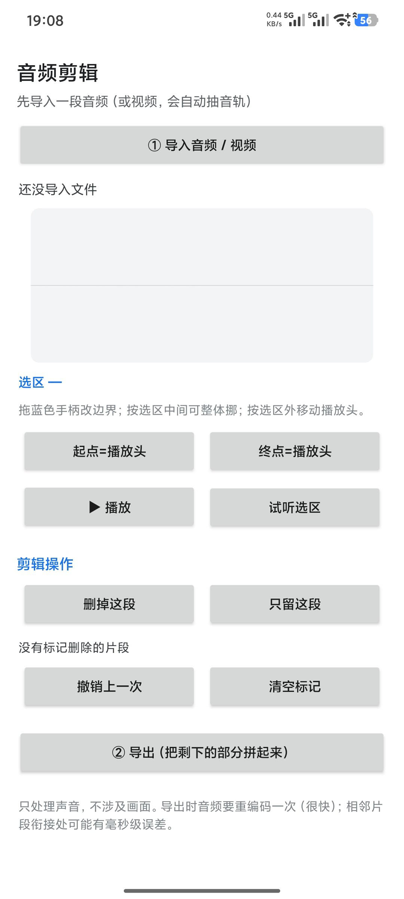
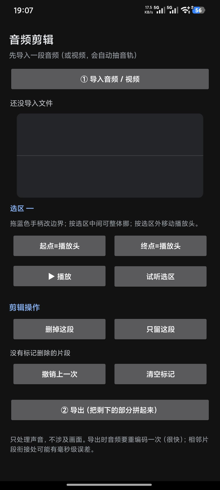

# 声影工坊

[English](README.md) | 中文说明

**Android 本地音视频提取 / 剪辑工具。内置 ffmpeg，装完即用：完全离线、零第三方依赖、无广告、无登录。**

-3DDC84)


-lightgrey)

---

## 这是什么

一个装在手机上就能用的音视频小工具：从视频里把音频抽出来、按时间剪片段、在波形上删掉不要的段落再拼起来。

所有处理都在本机跑，用的是一起打进 APK 里的 **ffmpeg 静态二进制**。App 的清单里**没有 `INTERNET` 权限** —— 不是"承诺不联网"，是系统层面它就没有联网的能力。

| 项 | 值 |
|---|---|
| 应用名 | 声影工坊 |
| 包名 | `com.mediakit.app` |
| 版本 | 1.1.0（versionCode 6） |
| 最低系统 | Android 7.0（API 24） |
| 目标系统 | Android 14（API 34） |
| 语言 / 依赖 | Kotlin，纯系统控件；运行期 `dependencies {}` 为空（junit 只给单测用），连 androidx 都不用 |
| 内置引擎 | ffmpeg 3.3.2 静态构建（libx264 / libmp3lame / libfdk-aac / libopus / libvorbis） |
| 网络权限 | **无** |
| 安装包 | 全量版 33.7 MB（4 ABI）／arm64 版 8.7 MB |

---

## 截图

**主界面**（左：浅色 / 右：深色）

<p align="center">
  
  
</p>

**音频剪辑器**（左：浅色 / 右：深色）

<p align="center">
  
  
</p>

---

## 功能

### 1. 提取音频

| 输出 | 说明 |
|---|---|
| **m4a（无损）** | 源音轨是 AAC 时直接 `-c:a copy`，字节级搬运，几秒完成，音质零损失 |
| mp3 192k / flac / wav | 需要时自动转码（libmp3lame / flac / pcm_s16le） |

不会给你造"假 m4a"——源音轨不是 AAC 而你又选了 m4a，它会老老实实转成 AAC 再装进 m4a 容器。

### 2. 剪辑片段

- **快速剪**：`-c copy` 流复制，不重编码，秒级完成；切口会吸附到最近的关键帧
- **精确剪**：libx264 重编码，切口一秒不差，慢一些
- 支持只保留音频（视频轨丢掉）

### 3. 音频剪辑器

点「编辑音频」进入：波形时间轴 + 双滑块选区 + 多段删除 + 拼接导出。

- 波形按 1600 个采样桶绘制，滑动流畅
- 选中一段标记删除，可以标记多段，支持撤销 / 清空
- 支持"只保留选区"反向操作
- 选区可试听（MediaPlayer，避免长素材从头等到尾）
- 导出时用 `atrim` 切出保留段再 `concat` 拼接，音频重编码很快

导入视频也行：会先自动抽音轨，再进剪辑器。

### 4. 系统分享入口

别的 App（相册、文件管理器、微信）里"分享 → 声影工坊"可以直接把视频/音频送进来，不用先在 App 里翻路径。

### 5. 结果落盘与「查看」

`Download/`

结果通过 MediaStore 直接写进公共 `Download` 目录，不建子文件夹。同名文件自动加 ` (1)`、` (2)`，不覆盖。

导出成功后的「查看」按钮会按品牌依次探测厂商文件管理器（小米 / OPPO / 一加 / vivo / 华为 / 荣耀 / 三星 / 魅族 / 联想），找不到再退回系统 DocumentsUI，全失败则把路径复制进剪贴板并提示——不会出现"点了没反应"。

### 6. 命令行版（Python）

`python/` 目录下是同一套需求在电脑 / Termux 上的实现，纯标准库 + 系统 ffmpeg，不装任何包就能跑（想装成命令也可以 `pip install -e python/`）：

```bash
python3 main.py                      # 交互式菜单
python3 -m mediakit.cli info 视频.mp4
python3 -m mediakit.cli extract 视频.mp4 -f mp3 -b 320k
python3 -m mediakit.cli clip 视频.mp4 --start 0:10 --end 0:40 --precise
python3 -m mediakit.cli batch /sdcard/Movies -f m4a
```

详见 [python/README.zh-CN.md](python/README.zh-CN.md)。

---

## 下载安装

到 [Releases](https://github.com/timo516/shengying-gongfang/releases) 页面下载：

| 文件 | ABI | 大小 | 适合谁 |
|---|---|---|---|
| `shengying-gongfang-1.1.0-arm64.apk` | arm64-v8a | 8.7 MB | 近几年几乎所有手机，**优先选这个** |
| `shengying-gongfang-1.1.0-full.apk` | arm64-v8a / armeabi-v7a / x86 / x86_64 | 33.7 MB | 32 位老机型、模拟器、不确定架构时 |

安装时系统会提示「未知来源应用」，允许即可；未上架任何应用商店。

> **签名说明**：1.0.3 起换成正式签名（RSA 4096，有效期至 2056 年），与 1.0.0～1.0.2 的 debug 签名**不兼容**。如果你装过旧版，需要先卸载再装 1.0.3，否则会报「应用未安装 / 签名不一致」。之后各版本都能直接覆盖升级，1.1.0 沿用同一张证书。

### 验证安装包

**唯一官方发布渠道是本仓库的 Releases 页面：**
<https://github.com/timo516/shengying-gongfang/releases>

只有在上面发布的安装包才是未被篡改的原始版本。网盘、论坛、第三方应用站、群里转发的安装包都无法确认来源——重新打包过的 APK 可以额外加入权限，所以「无网络权限」这个保证只对原版成立。

**签名证书 SHA-256** —— 1.0.3 的 v1 / v2 / v3 三个签名块用的是同一张证书，本项目后续版本也会继续使用（换证书会导致老用户无法覆盖升级）：

```
EF:4C:A4:77:06:01:7A:BE:4A:19:2C:11:52:7B:0C:7D:6C:B9:A2:B8:D6:70:A1:87:66:67:D2:64:13:ED:39:9E
```

自己校验，装了 Android SDK 的话：

```bash
apksigner verify --print-certs shengying-gongfang-1.1.0-arm64.apk
```

只有 JDK 也行：

```bash
keytool -printcert -jarfile shengying-gongfang-1.1.0-arm64.apk
```

输出里必须包含上面那串指纹；对不上就说明不是原版，别装。

**文件校验值（SHA-256）：**

| 文件 | SHA-256 |
|---|---|
| `shengying-gongfang-1.1.0-arm64.apk` | `ac2e38b1b49e4bd84db02b6bf99852851c61e8890040df90421d08929c84cd63` |
| `shengying-gongfang-1.1.0-full.apk` | `b3ef52d3ec66b90d9d4c3c5b5db532c85d7eabd6661096898142bfd6093e251b` |

手机上也能自查两步：

1. 设置 → 应用 → 声影工坊 → 权限，不应出现任何「网络」相关权限
2. 任意「APK 签名校验」类应用，显示的证书指纹应与上面一致

---

## 项目结构

```
.
├── docs/screenshots/           # 界面截图（浅色 / 深色）
├── android/                    # Android App（Kotlin，零依赖）
│   ├── BUILD.md                # 构建、打包、真机验收说明
│   ├── build.gradle            # AGP 8.5.2 / Kotlin 1.9.24
│   ├── settings.gradle
│   ├── gradle.properties
│   ├── JNILIBS.md              # 内置 ffmpeg 二进制的来源、许可与替换方法
│   └── app/
│       ├── build.gradle
│       └── src/main/
│           ├── AndroidManifest.xml
│           ├── java/com/mediakit/app/
│           │   ├── MainActivity.kt        # 单页主流程：选文件 → 看信息 → 抽音频 / 剪片段
│           │   ├── AudioEditorActivity.kt # 波形剪辑器：选区 / 多段删除 / 拼接导出
│           │   ├── BaseActivity.kt        # 公共控件构造 + 「界面还活着吗」
│           │   ├── Ffmpeg.kt              # 定位并执行 libffmpeg.so，解析 -progress
│           │   ├── FfmpegArgs.kt          # 纯函数：按容器 / 编码拼参数（有单测）
│           │   ├── Fmt.kt                 # 时间解析与格式化（一律 Locale.US）
│           │   ├── Timeline.kt            # 保留段合并、总时长、波形分桶（有单测）
│           │   ├── Names.kt               # 文件名清洗与去重（有单测）
│           │   ├── Storage.kt             # 空间检查、缓存工作目录
│           │   ├── MediaInfo.kt           # 时长 / 分辨率 / 有无音轨
│           │   ├── Output.kt              # 落盘、重名处理、跳转文件管理器
│           │   ├── Perm.kt                # 存储权限
│           │   ├── WorkService.kt         # 前台 Service（长任务不被回收）
│           │   ├── LongTask.kt            # 长任务提醒 + 保持亮屏
│           │   └── WaveView.kt            # 波形绘制
│           ├── res/                       # 主题（含深色）、自适应图标
│           └── jniLibs/arm64-v8a/libffmpeg.so   # 内置 ffmpeg（17 MB，别删别改名）
├── tools/
│   ├── make-fixtures.sh         # 生成回归样本（本机需要 ffmpeg）
│   └── smoke.sh                 # 13 项命令行冒烟测试（含 3 项负向对照）
├── .github/workflows/ci.yml     # CI：Python 单测 + Android 单测 + lint
└── python/                     # 命令行 / 电脑版（纯标准库）
    ├── main.py
    ├── mediakit/               # info / extract / clip / batch / check
    ├── tests/                  # unittest（22 项）
    ├── pyproject.toml          # 可选：pip install -e . 装成命令
    └── README.md
```

---

## 从源码构建

详细步骤见 [android/BUILD.zh-CN.md](android/BUILD.zh-CN.md)，最短路径：

```bash
cd android
echo "sdk.dir=/path/to/Android/Sdk" > local.properties   # 或用 ANDROID_HOME
gradle assembleRelease            # 需要 JDK 17 + Gradle 8.7 + SDK 34
gradle testDebugUnitTest          # JVM 单测：时间解析 / 参数拼装 / 保留段合并
```

> 仓库里只带了 **arm64-v8a** 的 `libffmpeg.so`（17 MB，为了不让 clone 变得很痛苦）。想打全量四 ABI 包，按 [android/JNILIBS.zh-CN.txt](android/JNILIBS.zh-CN.txt) 补齐其余三份，再 `gradle assembleRelease -Pabi=arm64-v8a,armeabi-v7a,x86,x86_64`。

签名的密码**不在仓库里**。要用自己的签名，复制 `android/keystore.properties.example` 为 `android/keystore.properties` 填好；没有这个文件时会出 unsigned 包，照样能编过。

---

## 几个"改了就会坏"的地方

这些是这个项目踩过的坑，写在这里免得后来者重踩：

1. **`libffmpeg.so` 其实是可执行文件，不是真 `.so`。** 改名只是为了能被 Gradle 当 native 库打进 APK 的 `lib/` 下。
2. **`useLegacyPackaging = true` 不能关。** Android 从 API 29 起禁止执行 data 目录里的文件，`nativeLibraryDir` 是唯一合法的可执行位置；关掉它，二进制不会被解压成真实文件，App 一启动就报「找不到 ffmpeg」。（1.1.0 起 manifest 里手写的 `extractNativeLibs` 已删除：AGP 会按 `useLegacyPackaging` 自动写回，两边都写反而冲突。）
3. **`abiFilters 'arm64-v8a'` 别删。** 包里没有别的 ABI 的二进制，多声明只是让包变大。
4. **不要加 `INTERNET` 权限。** 「完全离线」这个卖点就写在这一行。
5. **别把 `keystore.properties` / `.jks` 提交进仓库。**

另外修过的几个 bug（都已在当前代码里）：

| 问题 | 原因 | 修法 |
|---|---|---|
| 「查看」按钮点了没反应 | `setData()` 和 `setType()` 互相清空对方 | 统一用 `setDataAndType(uri, type)` |
| ffmpeg 卡死后所有按钮永久禁用 | 没有超时 | 看门狗：时长 × 4 + 120 秒，夹在 180 秒～30 分钟，超时 `destroyForcibly()` |
| GB 级视频把内部存储塞爆 | 无脑整文件复制进 `cacheDir` | 复制前查文件大小与可用空间，留 50 MB 余量并给出可读提示 |
| 超长文件名崩溃 | 只替换非法字符、不限长度 | 截断到 80 字符并保留扩展名 |
| 目标目录突然不可写就硬失败 | 没兜底 | 捕获后自动降级到 `Download/` |
| 音频装进 `.mp4` 后缀 | 后缀按源容器写 | 按实际编码决定容器 |
| 音频流 `-ss` 前置多出 0.03 秒 | 参数顺序 | 调整 `-ss` 位置，切口准确 |
| 带字幕的 mkv / opus 音轨 / wav 源「快速剪」必定失败 | 固定 `-map 0` + 输出写死 `.mp4` | 只映射首条音视频轨，输出容器跟着源文件走 |
| 输入 `1:70` 被悄悄当成 130 秒 | 时间解析不校验每段范围 | 越界直接判为非法，不替用户猜 |
| 任务失败后按钮要空等冷却 | 冷却计时不看结果 | 只有成功才进冷却 |
| 切后台做长任务被系统杀掉 | 没有前台 Service | `dataSync` 前台 Service + 通知栏进度 |

---

## 已知限制

- 本仓库默认只打 **arm64-v8a**；32 位设备请用 Release 里的 full 包（`armeabi-v7a` 也在里面）。
- 内置 ffmpeg 是 3.3.2（2018 年构建），换来的是体积可控。AV1、VVC 这类新编码不在支持范围内；主流 H.264 / H.265 / AAC / MP3 / FLAC / Vorbis / Opus 都有。
- 快速剪依赖关键帧，切口会吸附；要严格对时就选精确剪。
- 长任务跑在 `dataSync` 前台 Service 里：切到后台只要通知栏还挂着进度通知，就不容易被系统回收；但电池优化太激进的机型仍可能动手，超长素材建议别手动划掉 App。

---

## 隐私

- 无 `INTERNET` 权限，物理上无法上传任何东西。
- 不收集设备信息、不埋点、不需要账号。
- 处理的文件只在本地读写；临时文件在任务结束后清理。

---

## 安全

发现问题请走私下渠道，见 [SECURITY.md](SECURITY.md)，不要在公开 issue 里贴细节。

1.0.3 起签名证书指纹已公布（见 [验证安装包](#验证安装包)），对不上的包不是原版。

---

## 鸣谢与许可

- 本仓库代码：[MIT](LICENSE) © 2026 timo516
- 内置 ffmpeg 为 **GPL** 授权的静态构建，二进制取自 [Khang-NT/ffmpeg-binary-android](https://github.com/Khang-NT/ffmpeg-binary-android)（release `2018-07-31`，ffmpeg 3.3.2，NDK r15c 构建，API 21+）。若你要再分发打包了该二进制的 APK，请自行遵守 GPL 的相关要求。
- 图标为项目自制矢量图。
